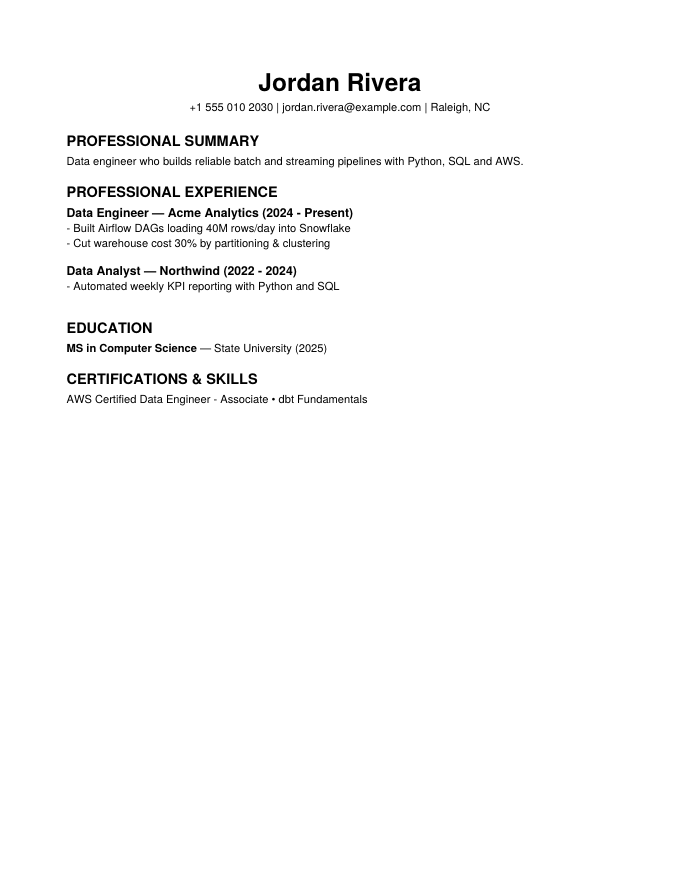
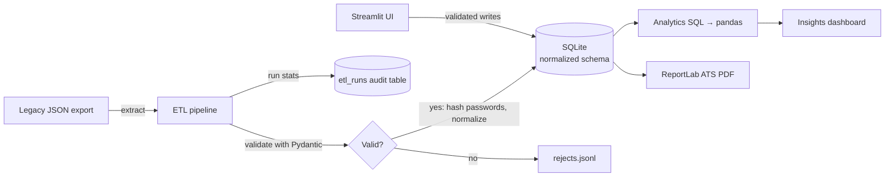
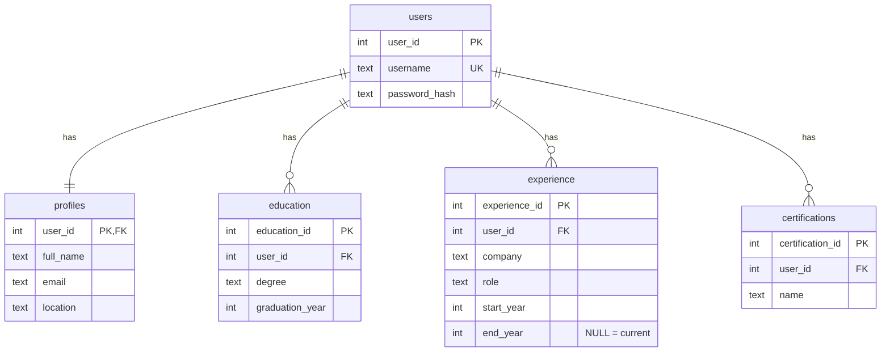

# Profile Craft

[](https://github.com/Vamsi4434/Profile-Craft/actions/workflows/ci.yml)


A resume builder with a data-engineering backbone. Users build a profile in a
Streamlit UI and export an ATS-friendly PDF. Underneath, every record passes
through **Pydantic data contracts** into a **normalized SQLite schema**. A
**batch ETL pipeline** migrates legacy JSON exports with reject handling and
run auditing, and an **analytics layer** answers questions about the data in SQL.

<p align="center"></p>

## Highlights

| Area | What it does |
|---|---|
| **Data modeling** | 3NF relational schema (users → profiles → education / experience / certifications) with foreign keys, `ON DELETE CASCADE`, `CHECK` constraints and indexes. See [`sql/schema.sql`](sql/schema.sql). |
| **Data quality** | Pydantic models validate emails, phone numbers, year ranges and date ordering at the edge. Free-text fields like `"2022 - Present"` or `"Class of 2023"` are normalized into typed columns. |
| **Batch ETL** | `extract → transform → load` pipeline that is **idempotent** (safe to re-run), **transactional** per record, writes **rejected records with reasons** to a JSONL file, and logs each run to an `etl_runs` audit table. |
| **Analytics** | SQL (CTEs, correlated subqueries, aggregation) exposed as pandas DataFrames and shown on an Insights dashboard: profile completeness, top certifications, years of experience, pipeline history. |
| **Security** | Passwords are salted and hashed with scrypt. The pipeline hashes any plaintext passwords found in legacy data during migration. |
| **Engineering** | 28 pytest tests, ruff linting, GitHub Actions CI across Python 3.11/3.12, and a Docker image that seeds demo data on first run. |

## Architecture



### Schema



## Quick start

```bash
git clone https://github.com/Vamsi4434/Profile-Craft.git
cd Profile-Craft
python -m venv .venv && source .venv/bin/activate
pip install -r requirements.txt

# Load the sample dataset (3 valid profiles, 3 deliberately invalid ones)
python -m profile_craft.pipeline.etl data/sample_users.json

streamlit run app.py
```

Log in with the demo account **`demo@profilecraft.dev` / `demo1234`**.

**With Docker:**

```bash
docker build -t profile-craft .
docker run -p 8501:8501 -v profile-data:/data profile-craft
```

## Running the pipeline

```text
$ python -m profile_craft.pipeline.etl data/sample_users.json
WARNING rejected bad-email@example.com: email: Value error, invalid email address: 'not-an-email'
WARNING rejected bad-dates@example.com: experience.0: Value error, end_year cannot be before start_year
WARNING rejected no-password@example.com: missing password
INFO read=6 loaded=3 rejected=3
Read 6 | loaded 3 | rejected 3
Rejected records written to data/rejects.jsonl
```

Running it twice produces the same database state: users are upserted and
child rows are replaced inside a transaction. A second row appears in `etl_runs`.

## Testing

```bash
pip install -r requirements-dev.txt
pytest -q        # 28 tests: models, hashing, DB layer, ETL, analytics, PDF
ruff check .
```

## Project structure

```text
├── app.py                      # Streamlit UI (thin: no business logic)
├── profile_craft/
│   ├── models.py               # Pydantic data contracts + normalization
│   ├── db.py                   # SQLite data-access layer, transactions
│   ├── security.py             # scrypt password hashing
│   ├── analytics.py            # SQL analytics → pandas
│   ├── pdf.py                  # ATS-friendly PDF export
│   └── pipeline/etl.py         # Batch ETL with rejects + run audit
├── sql/schema.sql              # DDL: tables, constraints, indexes
├── data/sample_users.json      # Synthetic sample data (no real people)
├── tests/                      # pytest suite
├── Dockerfile
└── .github/workflows/ci.yml
```

## Design decisions

- **Validate at the edge, not in the database alone.** Pydantic catches bad
  input with readable error messages. The schema's `CHECK` and foreign-key
  constraints act as a second line of defence.
- **Replace child rows instead of diffing.** A profile has only a handful of
  child rows, so delete-and-insert inside one transaction is simpler and just as
  safe as row-level merging.
- **SQLite for portability.** The data-access layer uses standard SQL and
  parameterized queries, so moving to PostgreSQL mostly means swapping the driver.

## Roadmap

- [ ] PostgreSQL backend via SQLAlchemy and Alembic migrations
- [ ] Orchestrate the ETL as an Airflow / Prefect DAG
- [ ] Export analytics tables to Parquet for downstream use
- [ ] Skill extraction from experience descriptions

## License

[MIT](LICENSE)
